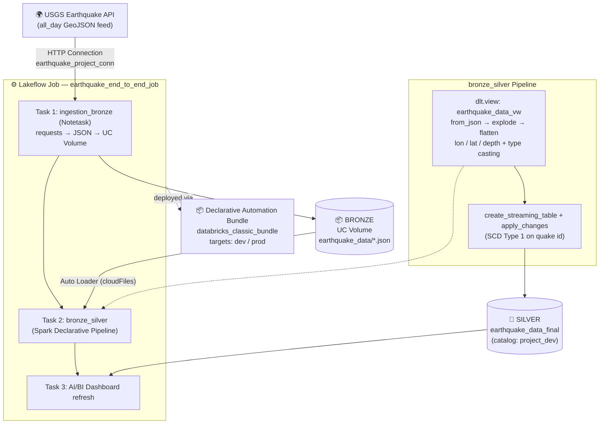

# 🌍 Earthquake End-to-End Data Engineering Platform on Databricks

A production-style lakehouse pipeline that ingests **real-time earthquake data** from the [USGS Earthquake API](https://earthquake.usgs.gov/), lands it as raw JSON in Unity Catalog Volumes (Bronze), cleans and flattens it with a **Spark Declarative Pipeline** (Silver), and serves it on an **AI/BI Dashboard** — orchestrated end to end by a multi-task **Lakeflow Job** and deployed as a **Declarative Automation Bundle (DAB)**.

---

## 📌 Project Overview

| Aspect | Detail |
| --- | --- |
| **Domain** | Real-time geospatial event analytics |
| **Source** | USGS Earthquake Hazards Program — `summary/all_day.geojson` feed |
| **Ingestion** | HTTP request → raw JSON → UC Volume (date-stamped files) |
| **Processing** | Auto Loader streaming → JSON parse → flatten GeoJSON → type casting → SCD Type 1 CDC |
| **Storage** | Unity Catalog (Delta Lake, Medallion Architecture) |
| **Serving** | AI/BI Dashboard (magnitude, location, alert tracking) |
| **Orchestration** | Lakeflow Job — dependency-chained multi-task workflow |
| **Deployment** | Declarative Automation Bundle with `dev` / `prod` targets |
| **Versioning** | Git-enabled Databricks workspace folder |

---

## 🏗️ Architecture Diagram



<details>
<summary>📄 Plain-text architecture (if Mermaid is not rendered)</summary>

```text
┌─────────────────────────┐
│   USGS Earthquake API   │  GeoJSON: summary/all_day
└────────────┬────────────┘
             │  UC HTTP Connection (earthquake_project_conn)
             ▼
┌─────────────────────────────────────────────┐
│ TASK 1 · ingestion_bronze (notebook)         │
│ GET GeoJSON → date-stamped JSON in volume    │
└────────────┬────────────────────────────────┘
             ▼
📦 BRONZE · /Volumes/project_dev/bronze/earthquake_data/earthquake_data_YYYY-MM-DD.json
             │  Auto Loader (cloudFiles streaming)
             ▼
┌─────────────────────────────────────────────┐
│ TASK 2 · bronze_silver (SDP)                 │
│ from_json → explode → flatten properties    │
│ geometry → longitude / latitude / depth      │
│ type casting (mag, time, felt, …)            │
│ apply_changes → SCD Type 1 on quake id       │
└────────────┬────────────────────────────────┘
             ▼
🥈 SILVER · earthquake_data_final (streaming table)
             │
             ▼
┌─────────────────────────────────────────────┐
│ TASK 3 · AI/BI Dashboard (SQL warehouse)     │
└─────────────────────────────────────────────┘

⚙️  Orchestrated by earthquake_end_to_end_job (dependency-chained tasks)
📦  Deployed by databricks_classic_bundle (DAB · dev/prod targets)
🔁  Version-controlled in Git
```

</details>

---

## 🧠 Key Concepts Used

1. **Medallion Architecture** — raw immutable JSON in Bronze → cleaned, typed, deduplicated Delta table in Silver.
2. **Unity Catalog Connections** — the external USGS HTTP API is registered as a governed UC connection (`earthquake_project_conn`), keeping credentials/URLs out of code and making environments portable.
3. **Unity Catalog Volumes** — governed cloud storage for raw landing files.
4. **Auto Loader (cloudFiles)** — incrementally and reliably processes new files as they arrive in the volume.
5. **Spark Declarative Pipelines (SDP, formerly DLT)** — declarative, tested transformations with built-in data quality: `dlt.view` → `create_streaming_table` → `apply_changes`.
6. **CDC with SCD Type 1** — earthquakes are keyed on their event `id` and sequenced by `_load_timestamp`, so re-reported events update in place instead of duplicating.
7. **Complex JSON handling** — schema enforcement with `from_json`, array `explode`, and nested GeoJSON flattening (`geometry.coordinates` → longitude / latitude / depth) plus explicit type casting.
8. **Lakeflow Jobs (multi-task)** — dependency-chained tasks: ingestion → pipeline → dashboard refresh, with a parameterized `catalog_name` for environment-agnostic runs.
9. **Declarative Automation Bundles (DABs)** — `databricks.yml` defines variables (`catalog`, `schema`), `dev`/`prod` targets, deployment modes, and permissions — enabling one-command, reproducible CI/CD deployments.
10. **AI/BI Dashboards** — dashboard attached as a job task, so visualizations refresh automatically after every pipeline run.

---

## 🛠️ Tech Stack

`Databricks` · `Unity Catalog` · `Delta Lake` · `PySpark` · `Spark Declarative Pipelines (DLT)` · `Auto Loader` · `Lakeflow Jobs` · `Declarative Automation Bundles` · `AI/BI Dashboards` · `SQL` · `Python` · `Git`

---

## 📁 Repository Structure

```text
databricks_classic_bundle/
├── databricks.yml                 # DAB definition: variables, dev/prod targets
├── resources/
│   ├── earthquake_job.job.yml      # Multi-task job: ingest → pipeline → dashboard
│   └── databricks_classic_bundle_etl.pipeline.yml
├── src/
│   ├── notebooks/
│   │   └── ingestion_bronze        # TASK 1: USGS API → Bronze volume
│   └── DLT_Pipelines/
│       └── bronze_silver/
│           ├── transformations/
│           │   └── cleaned_earthquake_data.py   # TASK 2: SDP Bronze→Silver
│           ├── explorations/       # Ad-hoc analysis notebooks
│           └── utilities/          # Helper functions / UDFs
└── tests/                          # Pytest suite
```

---

## 🚀 How to Run

1. **Deploy the bundle** — deploy `databricks_classic_bundle` to the `dev` (or `prod`) target from the Databricks Deployments panel or CLI.
2. **Run the job** — trigger `earthquake_end_to_end_job`; it runs ingestion, the pipeline, and the dashboard refresh in order.
3. **Query the Silver table** — `SELECT * FROM project_dev.dev.earthquake_data_final`.
4. **Explore** — open the explorations notebook or the AI/BI dashboard for insights.

---

## ✨ Sample Output

The final Silver table contains one row per earthquake event with: `id`, `mag`, `place`, `time` (timestamp), `tsunami`, `felt`, `longitude`, `latitude`, `depth`, and `_load_timestamp`.
